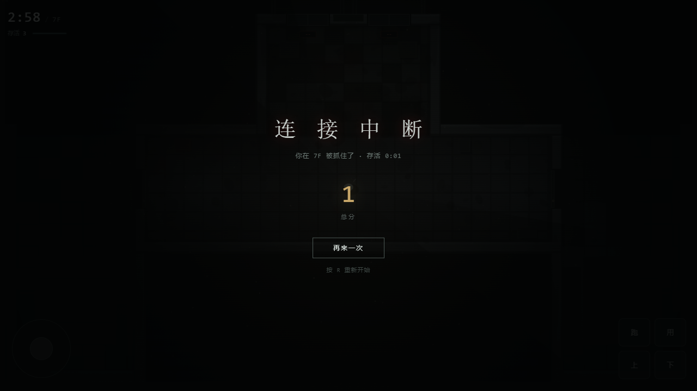
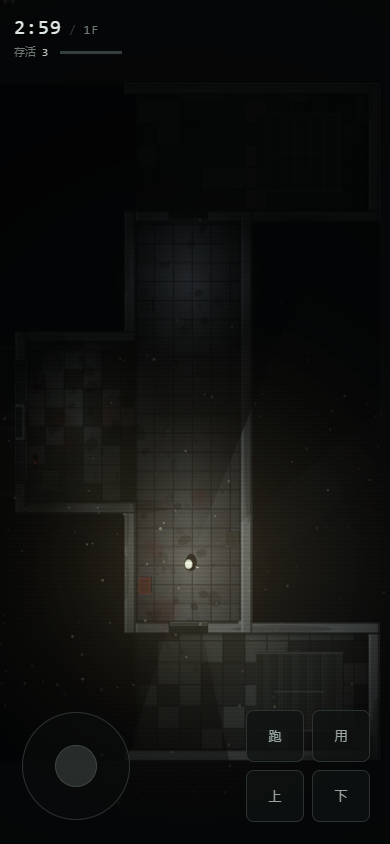

# 电梯公寓大逃杀 2

一栋 20 层的公寓，两部电梯（C / D），两部互相看不见的楼梯。
你是被困在里面的三个小孩之一，另外两个由 AI 扮演；
楼里还有两个"住户"，它们共用一个频道，会在楼道里互相通气。

俯视 2D，手电光之外什么也看不见。


- **双击 `index.html` 就能玩**：纯前端、零依赖、不联网、没有外部图片或音频文件
- 画面、光照、声音全部由代码实时生成
- 手机竖屏会自动把整层平面转 90°（长边走竖屏方向）

---

## 怎么玩

| 操作 | 作用 |
|---|---|
| `WASD` / `方向键` | 走动 |
| `Shift` | 冲刺（有体力条，跑起来声音传得远） |
| `E` | 推门 / 呼梯 / 在轿厢里开门 |
| `Q` | 关电梯门 / 楼梯间里下楼 |
| `楼梯间里 W / S` | 上楼 / 下楼（走一段换一个楼梯间） |
| `Space` | 出轿厢（门开着时） |
| `F` | 手电开关 |
| `M` | 静音 |
| `Esc` | 暂停 |
| 鼠标 | 点地面走过去；点楼梯门（会自动走到门前再推开）；点电梯门旁的 ▲▼ 呼梯（会自动走过去再按）；点轿厢走进去；点楼梯段自动上楼/下楼 |
| 触屏 | 左下摇杆 + 右下「跑 / 用 / 上 / 下」 |

进了轿厢，右侧会亮起楼层面板：点楼层（或数字键）、开门、关门、出去。

### 目标

活到天亮（180 秒）。

- 三个小孩，谁被抓住就少一个；**你被抓到就结束**。
- 存活时间就是分数。
- 电梯厅的呼梯是共用的：按一下，哪部先到算哪部。
- 楼梯是 **A(n) ↔ B(n±1)**：从左边楼梯间上楼，会从右边楼梯间出来，反之亦然 —— 两部楼梯互不相通，只能靠换层。

---

## 氛围

- **手电锥**：只有光锥里、且没被墙挡住的东西才看得见；锥外是近乎全黑。
- **吊灯**：每层走廊三盏应急灯，昏黄、会闪，偶尔整个暗下去半秒。
- **声音**：走廊嗡鸣、远处金属撞击、脚步、推门的吱呀、电梯到站的铃。
- **心跳**：它靠近时，你会听见自己的心跳，画面四周开始渗红。
- **尘埃**：光柱里浮着的灰。
- **胶片颗粒 + 扫描线 + 暗角**：整幅画面像一段旧监控。
- **血迹**：有人被抓住的地方会留下暗红的一摊。






---

## 数值

**玩家端不提供任何可调项**。所有数值都写死在 `js/config.js`，改完刷新即可。
调参速查表见 [`DEV.md`](DEV.md)。

当前这套数值里，直接挂钩美术与版面的几个（**不要随便改**，改了要重新看画面）：

| 常量 | 值 | 说明 |
|---|---|---|
| `FLOOR_LEN` | 18.0 m | 一层总长：楼梯间 3.2 + 走廊 3.6 + 电梯厅 4.4 + 走廊 3.6 + 楼梯间 3.2 |
| `CORRIDOR_W` | 2.9 m | 走廊宽 |
| `STAIR_W` / `STAIR_D` | 3.2 / 6.4 m | 楼梯间面宽 / 进深（含楼梯段） |
| `HALL_W` / `HALL_D` | 4.4 / 3.0 m | 电梯厅面宽 / 向北凹进的深度 |
| `WALL_T` | 0.3 m | 墙厚 |
| `CAR_W` / `CAR_D` | 1.7 / 1.6 m | 轿厢内净尺寸 |

整层平面 18.6 × 10.15 m（含墙），在 16:9 屏幕上约 67 px/m，人物直径约 30 px。

---

## 项目结构

```
ElevatorKill2/
├─ index.html        # 页面骨架、HUD、轿厢面板、结算层
├─ styles.css        # 全部界面样式（含竖屏适配）
├─ js/
│  ├─ config.js      # ★ 唯一数值入口
│  ├─ geom.js        # 楼层平面（米制）：墙、门洞、楼梯、井道、视线与碰撞
│  ├─ world.js       # 世界状态：电梯队列、门、噪声、抓人判定、玩家动作
│  ├─ ai.js          # 小孩 AI、杀人犯 AI（巡逻 / 听声 / 追击 / 频道）
│  ├─ audio.js       # WebAudio 合成音效（无音频文件）
│  ├─ render.js      # 俯视绘制：烘焙地砖、光锥、尘埃、胶片颗粒
│  ├─ input.js       # 键鼠 + 触屏摇杆
│  ├─ ui.js          # HUD / 轿厢面板 / 提示 / 结算
│  └─ main.js        # 主循环与交互装配
├─ tools/            # 本地静态服务器 + 无头跑局脚本
├─ screenshots/
├─ README.md
└─ DEV.md            # 开发者调参手册
```

## 兼容性

- Chrome / Edge / Firefox / Safari 现代版本。
- `file://` 直接双击可用（都是普通 `<script>`，没有模块化、没有 fetch）。
- 如果浏览器对本地文件限制较多，也可以在目录里 `python -m http.server 8000`，或 `node tools/serve.js 5199`。

## 已知限制

- 只有一栋楼、一种玩法；没有存档（只把分数留在内存里）。
- 音效是合成的，"她/他"没有配音。
- 没有英文版。
