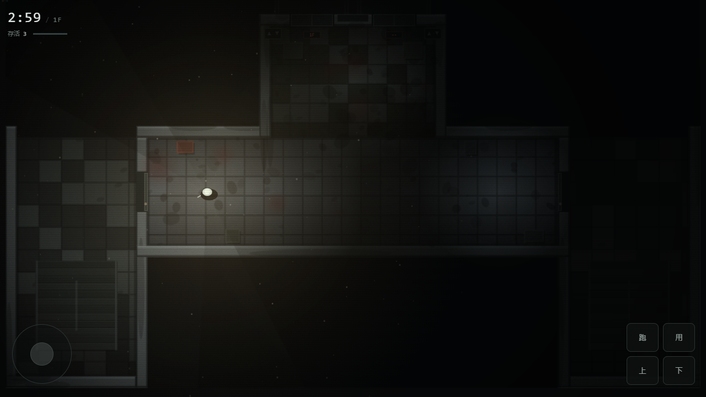
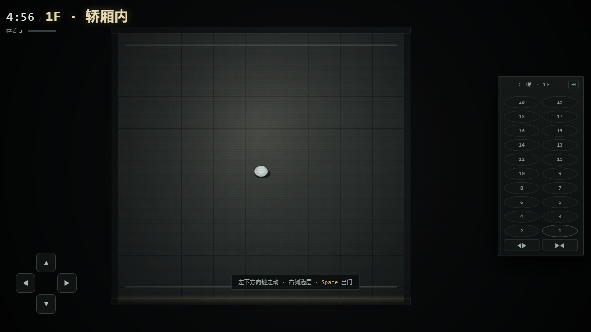

# 电梯公寓大逃杀 2

一栋 20 层的公寓，两部电梯（C / D），两部互相看不见的楼梯。
你是被困在里面的三个小孩之一，另外两个由 AI 扮演；
楼里还有两个"住户"，它们共用一个频道，会在楼道里互相通气。

俯视 2D，手电光之外什么也看不见。



- **双击 `index.html` 就能玩**：纯前端、零依赖、不联网、没有外部图片或音频文件
- 画面、光照、声音全部由代码实时生成
- 手机竖屏会自动把整层平面转 90°（长边走竖屏方向）

---

## v1.4 变更

- **楼梯也能按**：走到楼梯口会弹出 `▲ 上楼 / ▼ 下楼` 两个按钮，纯鼠标就能上下楼（1 楼按不了下楼、20 楼按不了上楼）。键盘 `E/Q` 照旧。
- **电梯核心按一代的 SCAN 重写**：
  - 每个方向一条「事件队列」，每帧重算：轿厢选层 + 同方向的呼梯；
  - 每跨过一层就重新问一次要不要停 —— **该停的层绝不开过去**（这就是「按了 5 楼却冲到 20 楼」的根因）；
  - 反方向呼梯不停，等当前方向跑空、到了整层才掉头；
  - 两边都没活 → 原地待机；停在半层 → 先挪到最近整层再待机；
  - 关门途中同层又被叫 → 重新开门（并且这次会真的把呼梯消掉，不再开开合合）。
- 新增回归测试 `tools/elevator-test.js`（11 条用例，全部通过）。

## v1.3 变更

- **呼梯改成按方向**：现在按的是「▲ 我要上楼」或「▼ 我要下楼」，不再是叫某一部指定的电梯；哪部梯先到就哪部来服务。
- **端头限制**：1 楼按不了 ▼、20 楼按不了 ▲（按钮变灰，键盘也按不出来）。
- **面板信息**：呼梯面板仍然同时显示两部梯的当前楼层和运行方向（`C 梯 1F · 本层` / `D 梯 20F ▼`）。
- **键盘**：电梯厅里 `E` = 呼上、`Q` = 呼下；楼梯间里 `E/Q` 仍是上楼/下楼；轿厢里仍是开/关门。

## v1.2 变更

- **寻路全程自动开门**：不再只有走楼梯时开门。只要路径经过关着的楼梯门，走近就自动推开（玩家、AI 都一样）。
- **楼梯提示精简**：只写 `E 上楼 · Q 下楼`，不再带括号说明。
- **楼梯过场画面**：上下楼时真的能看到一段楼梯——踏面/踢面、扶手、正在爬的人、上一层的楼层号和进度条；有上下楼任务时自动走完这段。
- **楼层号放大**：HUD 上的 `12F` 现在是 30px 的暖黄大字；一局时长从 3 分钟改成 **5 分钟**。
- **恐怖氛围音效**：加了混响（1.8 秒合成脉冲响应）与一整套随机环境声——耳语、木头/楼板开裂、远处的脚步、管道敲击；紧张时会听见自己的呼吸和心跳；坐电梯有轿厢低频嗡鸣。

## v1.1 变更

- **楼梯不再和 W/S 打架**：上楼按 `E`、下楼按 `Q`，`W/S` 永远是前后平移；站在楼梯口会提示。
- **呼梯只有一个键**：一部梯一个「呼」按钮，不再分上下。走到电梯附近（约 5 米）才会出现**呼梯面板**，面板上直接显示两部梯当前的楼层和运行方向（如 `12F ▲`）；面板没出现时键盘也按不到。
- **轿厢里能走动**：轿厢内也能移动（脚步很轻），不再站着不动。
- **轿厢面板改成 11 行 × 2 列**：10 行楼层（20/19 … 2/1）+ 最后一行**开门 / 关门的图标键**；右上角 ⇥ 是出梯，点画面下半部分也能出梯。
- **真·自动寻路**：新增 `js/nav.js`（0.2 m 网格 A* + 路径拉直），玩家与 AI 都走网格路径，不再直勾勾撞墙；**路上遇到关着的楼梯门会自动推开**。
- **小孩不再抽搐**：目标锁定（一个目标走到底，到站先歇 1~3 秒），换层只认一个楼梯间，去掉了原地抖动。
- **杀人犯更凶**：视野 11.5 m、半角 77°、听走路 8 m、听冲刺 14 m、追击 3.05 m/s；追击时**盯住本人实时位置**（不追残影）；等电梯超过 9 秒会改走楼梯。
- **电梯停靠规则再对齐**：站在整层且有本层呼梯时一定先开门；只在本方向没有剩余任务时才掉头；关门途中又被叫会重新打开。

## 怎么玩

| 操作 | 作用 |
|---|---|
| `WASD` / `方向键` | 走动 |
| `Shift` | 冲刺（有体力条，跑起来声音传得远） |
| `E` | 推门 / 呼梯 / **楼梯间里上楼** / 轿厢里开门 |
| `Q` | **楼梯间里下楼** / 轿厢里关门 |
| `W` `S` | 始终是前后平移（楼梯间里也一样，不再和上下楼打架） |
| `Space` | 出轿厢（门开着时） |
| `F` | 手电开关 |
| `M` | 静音 |
| `Esc` | 暂停 |
| 鼠标 | 点地面（自动寻路走过去）· 点楼梯门（走到门前再推开）· 靠近电梯时出现**呼梯面板**（显示两部梯的楼层和方向，点「呼」叫梯）· 点轿厢走进去 · 点楼梯段自动上楼/下楼 |
| 触屏 | 左下摇杆 + 右下「跑 / 用 / 上 / 下」 |

进了轿厢，右侧会亮起楼层面板：点楼层（或数字键）、开门、关门、出去。

### 目标

活到天亮（180 秒）。

- 三个小孩，谁被抓住就少一个；**你被抓到就结束**。
- 存活时间就是分数。
- 电梯厅的呼梯是共用的：按一下，哪部先到算哪部。
- 楼梯是 **A(n) ↔ B(n±1)**：从左边楼梯间上楼，会从右边楼梯间出来，反之亦然 —— 两部楼梯互不相通，只能靠换层。

---

## 氛围

- **手电锥**：只有光锥里、且没被墙挡住的东西才看得见；锥外是近乎全黑。
- **吊灯**：每层走廊三盏应急灯，昏黄、会闪，偶尔整个暗下去半秒。
- **声音**：走廊嗡鸣、远处金属撞击、脚步、推门的吱呀、电梯到站的铃。
- **心跳**：它靠近时，你会听见自己的心跳，画面四周开始渗红。
- **尘埃**：光柱里浮着的灰。
- **胶片颗粒 + 扫描线 + 暗角**：整幅画面像一段旧监控。
- **血迹**：有人被抓住的地方会留下暗红的一摊。




---

## 数值

**玩家端不提供任何可调项**。所有数值都写死在 `js/config.js`，改完刷新即可。
调参速查表见 [`DEV.md`](DEV.md)。

当前这套数值里，直接挂钩美术与版面的几个（**不要随便改**，改了要重新看画面）：

| 常量 | 值 | 说明 |
|---|---|---|
| `FLOOR_LEN` | 18.0 m | 一层总长：楼梯间 3.2 + 走廊 3.6 + 电梯厅 4.4 + 走廊 3.6 + 楼梯间 3.2 |
| `CORRIDOR_W` | 2.9 m | 走廊宽 |
| `STAIR_W` / `STAIR_D` | 3.2 / 6.4 m | 楼梯间面宽 / 进深（含楼梯段） |
| `HALL_W` / `HALL_D` | 4.4 / 3.0 m | 电梯厅面宽 / 向北凹进的深度 |
| `WALL_T` | 0.3 m | 墙厚 |
| `CAR_W` / `CAR_D` | 1.7 / 1.6 m | 轿厢内净尺寸 |

整层平面 18.6 × 10.15 m（含墙），在 16:9 屏幕上约 67 px/m，人物直径约 30 px。

---

## 项目结构

```
ElevatorKill2/
├─ index.html        # 页面骨架、HUD、轿厢面板、结算层
├─ styles.css        # 全部界面样式（含竖屏适配）
├─ js/
│  ├─ config.js      # ★ 唯一数值入口
│  ├─ geom.js        # 楼层平面（米制）：墙、门洞、楼梯、井道、视线与碰撞
│  ├─ world.js       # 世界状态：电梯队列、门、噪声、抓人判定、玩家动作
│  ├─ ai.js          # 小孩 AI、杀人犯 AI（巡逻 / 听声 / 追击 / 频道）
│  ├─ audio.js       # WebAudio 合成音效（无音频文件）
│  ├─ render.js      # 俯视绘制：烘焙地砖、光锥、尘埃、胶片颗粒
│  ├─ input.js       # 键鼠 + 触屏摇杆
│  ├─ ui.js          # HUD / 轿厢面板 / 提示 / 结算
│  └─ main.js        # 主循环与交互装配
├─ tools/            # 本地静态服务器 + 无头跑局脚本
├─ screenshots/
├─ README.md
└─ DEV.md            # 开发者调参手册
```

## 兼容性

- Chrome / Edge / Firefox / Safari 现代版本。
- `file://` 直接双击可用（都是普通 `<script>`，没有模块化、没有 fetch）。
- 如果浏览器对本地文件限制较多，也可以在目录里 `python -m http.server 8000`，或 `node tools/serve.js 5199`。

## 已知限制

- 只有一栋楼、一种玩法；没有存档（只把分数留在内存里）。
- 音效是合成的，"她/他"没有配音。
- 没有英文版。
